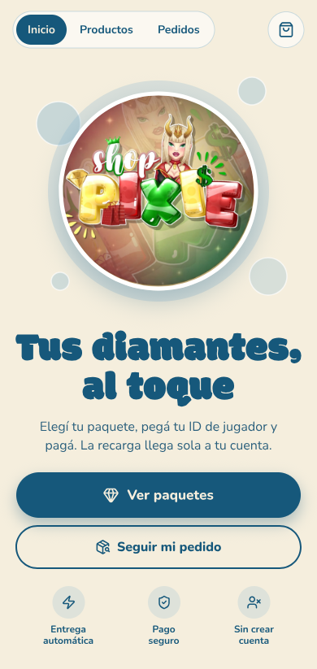
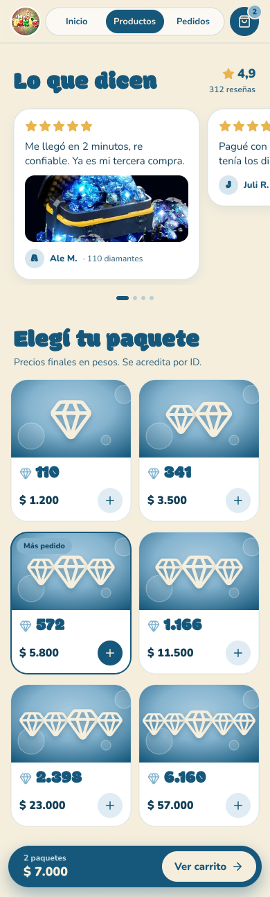
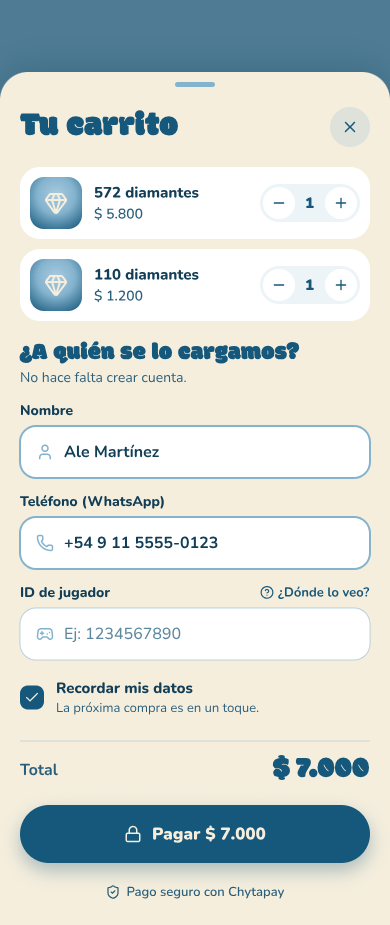
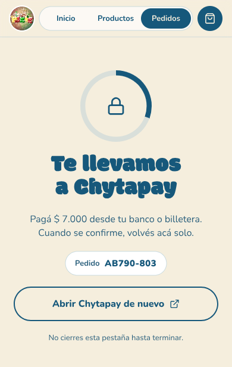
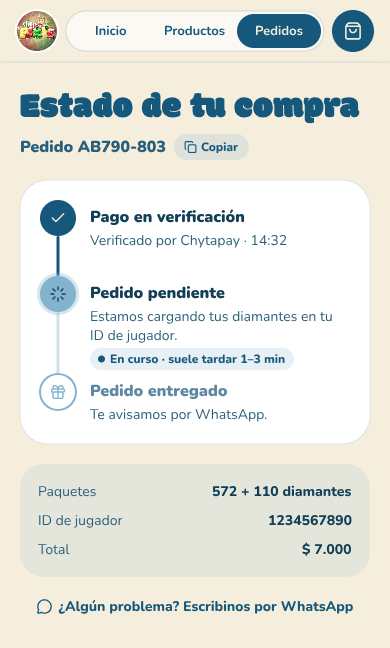
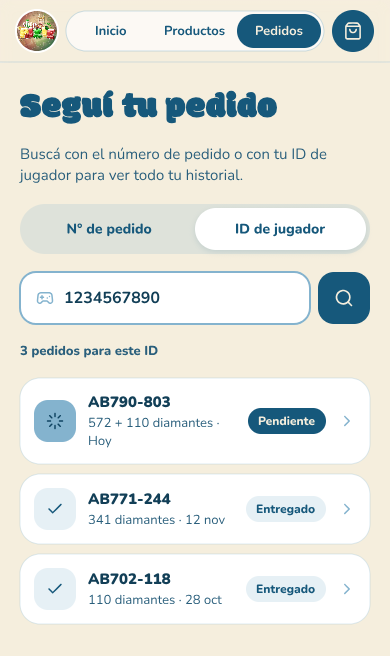
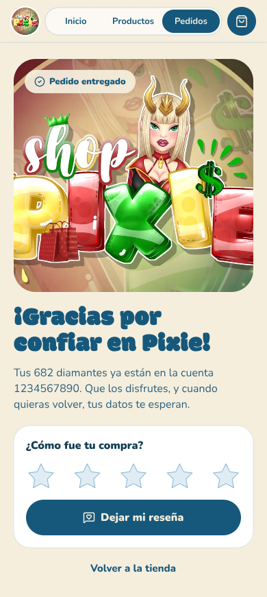
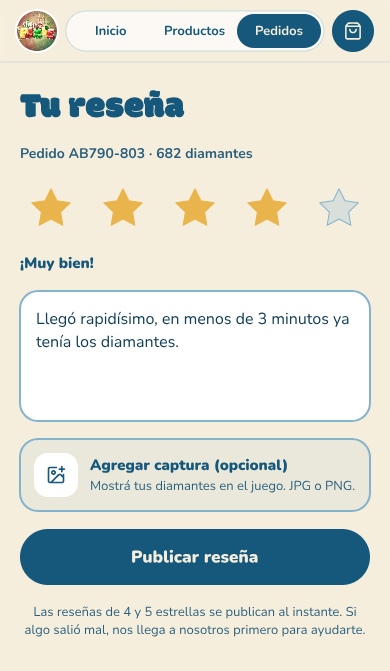

# Pixie Store

Tienda web de diamantes: elegí tu paquete, cargá tu ID de jugador, pagá y recibí la recarga automáticamente.

- **Frontend:** React + Vite
- **Backend:** Node + Express + Docker
- **Pagos:** Chytapay

## Estado
Etapa 1: diseño de pantallas (`webDesing.pen`, Pencil).

## Hoja de ruta
1. Diseño de pantallas
2. Frontend de la tienda
3. Backend, base de datos y pedidos
4. Pagos
5. Integración con el proveedor
6. Reseñas y moderación
7. Panel de administración
8. Deploy

## Pantallas (Etapa 1)
| Mobile | | |
|---|---|---|
|  |  |  |
|  |  |  |
|  |  | |

Desktop: [Inicio](design/exports/d1-inicio.png) · [Carrito](design/exports/d2-carrito-drawer.png) · [Entregado](design/exports/d3-pedido-entregado.png) · [Sistema de diseño](design/exports/00-sistema-diseno.png)
